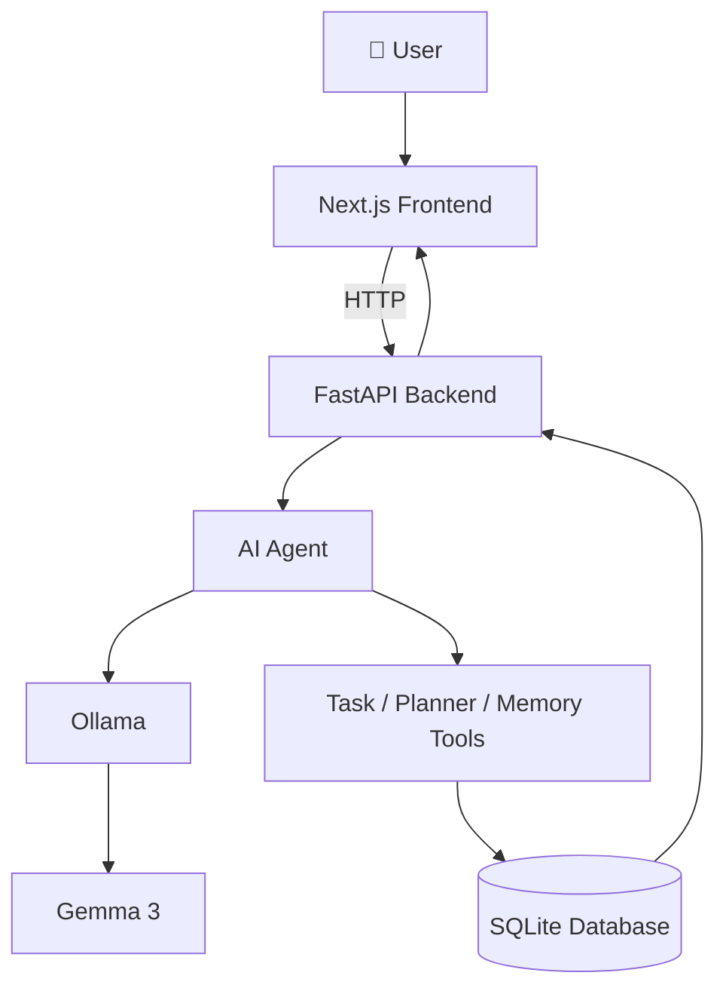

<div align="center">

# ✨ Unmess

### Turn the chaos in your head into a plan.

<p>
  <b>Unmess</b> is a local-first AI productivity assistant that turns messy thoughts and brain dumps into structured, actionable tasks.
</p>

<p>
  
  
  
  
</p>

<p>
  <i>You don't organize your thoughts first. Unmess does it for you.</i>
</p>

</div>

---

## 🧠 The Problem

Most productivity apps assume that you already know **what your tasks are**.

Real life is messier.

A typical brain dump might look like:

> "I have to finish my homework tomorrow, submit my exam form by midnight, study for my test on October 6th, send flowers to my friend, and buy groceries today."

That's not a task list.

It's a **brain dump**.

Before turning it into something useful, you normally have to:

- identify individual tasks
- find deadlines
- decide what's urgent
- remember dependencies
- create tasks manually
- prioritize everything

**Unmess moves that cognitive work to the AI.**

---

## 💡 The Idea

Traditional to-do apps ask:

> **"What tasks do you want to create?"**

Unmess asks:

> **"What's on your mind?"**

You write naturally.  
Unmess turns the mess into a plan.

### Example

**Input**

```text
I need to finish my homework tomorrow,
submit my exam form by midnight,
study for my test on October 6th,
send flowers to my friend,
and buy groceries today.
```

**Output**

| Task | Deadline | Priority |
|---|---|---|
| 🔴 Homework Assignment | Tomorrow | Critical |
| ⚠️ Submit Exam Form | Midnight | High |
| 📚 Study for Test | October 6 | High |
| 💐 Send Flowers | — | Low |
| 🛒 Buy Groceries | Today | Low |

---

# 🚀 Features

### 🧠 Brain Dump

Forget manually building a to-do list.

Just write what's in your head:

```text
I have way too much going on...
```

Unmess extracts the actionable work automatically.

---

### 🤖 AI Task Extraction

Unstructured thought → structured tasks.

```text
One messy paragraph
        ↓
Individual actionable tasks
```

---

### 📅 Natural-Language Deadlines

Unmess understands phrases such as:

```text
today
tomorrow
Thursday
October 6th
by midnight
next week
```

and converts them into structured deadline information.

---

### ⚡ Priority Detection

Tasks can be classified as:

**Critical · High · Normal · Low**

So urgent work can rise to the top instead of getting lost inside a giant list.

---

### 🔗 Dependency Detection

Unmess can recognize when one task needs another task to happen first.

```text
Get passport
     ↓
Submit internship application
```

---

### 💾 Persistent Task Storage

Tasks are persisted locally using:

**SQLite + SQLAlchemy**

Your tasks don't disappear when the session ends.

---

### 🏠 Local AI

Unmess is designed around **local inference through Ollama**.

That means the core AI workflow can run without requiring a proprietary AI API key.

Current development model:

```text
Gemma 3 1B
```

---

# 🏗️ How It Works



### Request Flow

```text
User
  ↓
Next.js Frontend
  ↓
POST /brain-dump
  ↓
FastAPI
  ↓
Ollama + AI Agent
  ↓
Structured JSON
  ↓
Validation / Normalization
  ↓
Task Creation
  ↓
SQLite
  ↓
Task Cards
```

---

# 🧩 Tech Stack

| Layer | Technology |
|---|---|
| **Frontend** | Next.js, React, TypeScript |
| **Styling** | Tailwind CSS |
| **Backend** | Python, FastAPI |
| **Validation** | Pydantic |
| **AI Runtime** | Ollama |
| **Model** | Gemma 3 1B |
| **Inference** | Local |
| **Database** | SQLite |
| **ORM** | SQLAlchemy |

---

# 📁 Project Structure

```text
unmess/
│
├── frontend/
│   ├── ...
│   └── package.json
│
├── backend/
│   ├── main.py
│   └── requirements.txt
│
├── README.md
└── .gitignore
```

> The project structure may evolve as planning, memory, and agent capabilities are expanded.

---

# ⚙️ Getting Started

## Prerequisites

Make sure you have:

- Python 3.11+
- Node.js
- npm
- Git
- Ollama

---

## 1. Clone the repository

```bash
git clone https://github.com/YOUR_USERNAME/unmess.git
cd unmess
```

---

## 2. Set up Ollama

Install Ollama:

**https://ollama.com**

Then pull the model:

```bash
ollama pull gemma3:1b
```

Make sure Ollama is running before starting the backend.

---

## 3. Start the backend

```bash
cd backend
python -m venv .venv
```

### Windows

```bash
.venv\Scripts\activate
```

### Install dependencies

```bash
pip install -r requirements.txt
```

### Run FastAPI

```bash
uvicorn main:app --reload
```

Backend:

**http://127.0.0.1:8000**

API docs:

**http://127.0.0.1:8000/docs**

---

## 4. Start the frontend

Open another terminal:

```bash
cd frontend
npm install
npm run dev
```

Frontend:

**http://localhost:3000**

---

# 🔐 Local-First by Design

Your thoughts can contain extremely personal information.

Unmess is therefore designed around a local-first workflow:

```text
┌─────────────────┐
│   Your Thoughts │
└────────┬────────┘
         ↓
┌─────────────────┐
│ Local Application│
└────────┬────────┘
         ↓
┌─────────────────┐
│   Local AI      │
│    Ollama       │
└────────┬────────┘
         ↓
┌─────────────────┐
│ Local SQLite DB │
└─────────────────┘
```

The goal is simple:

**your thoughts should not have to leave your machine just to become organized.**

---

# 🆚 Why Unmess?

A normal productivity workflow looks like:

```text
Think
  ↓
Figure out what the tasks are
  ↓
Create tasks manually
  ↓
Set deadlines
  ↓
Set priorities
  ↓
Organize everything
```

Unmess changes it to:

```text
Think
  ↓
Dump everything
  ↓
Unmess understands it
  ↓
Tasks + deadlines + priorities
  ↓
Actionable plan
```

The goal isn't to make another prettier to-do list.

The goal is to **remove the cognitive overhead between having a thought and knowing what to do next.**

---

# 🗺️ Roadmap

### ✅ Current

- [x] Brain dump input
- [x] AI task extraction
- [x] Deadline detection
- [x] Priority classification
- [x] Basic dependency detection
- [x] Persistent SQLite storage
- [x] Local AI inference through Ollama

### 🚧 Next

- [ ] Task completion checkboxes
- [ ] Edit generated tasks
- [ ] Delete tasks
- [ ] Dynamic task re-organization
- [ ] Persistent AI memory
- [ ] Random-thought organization
- [ ] Automatic task categorization
- [ ] Deadline reminders
- [ ] Calendar integration
- [ ] Task dependency visualization
- [ ] Adaptive prioritization
- [ ] More autonomous planning

---

# 🌱 Vision

Unmess is built around one simple idea:

> **Your productivity system shouldn't require you to already be productive.**

Real thoughts are messy.

Deadlines overlap.

Responsibilities live across conversations, notes, memory, and random thoughts.

Unmess aims to become an AI layer that can understand that mess and gradually turn it into something actionable.

```text
Messy Thoughts
      ↓
Understanding
      ↓
Tasks
      ↓
Priorities
      ↓
Plan
      ↓
Action
```

---

# 🤝 Contributing

Contributions are welcome.

```bash
git clone https://github.com/YOUR_USERNAME/unmess.git
cd unmess
git checkout -b feature/your-feature
```

Make your changes, test them locally, then:

```bash
git add .
git commit -m "feat: describe your change"
git push origin feature/your-feature
```

Open a Pull Request on GitHub.

---

# 👩‍💻 Built By

<div align="center">

### **Gauri Mishra**

Computer Science & Engineering student building with:

**AI Agents · Generative AI · Local AI · Developer Tools · Intelligent Productivity Systems**

</div>

---

# ⭐ Support

If Unmess is useful or interesting:

⭐ Star the repository  
💡 Suggest features  
🐛 Report bugs  
🔀 Contribute  
📢 Share it with someone who has **way too much going on**

---

<div align="center">

## ❤️ Just dump it. Unmess it.

**October 5, 2026**

</div>
